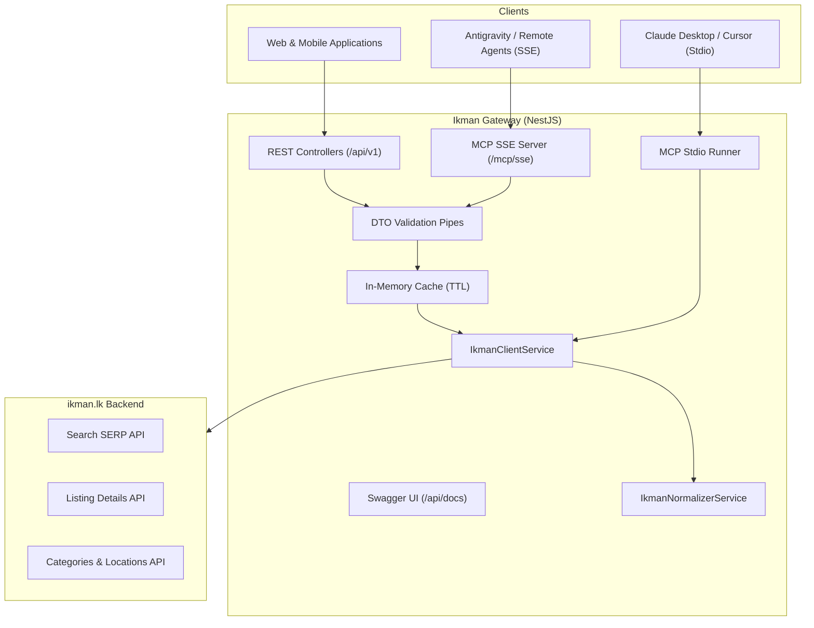

# Ikman Gateway & Headless MCP Server

<div align="center">


**A clean, production-grade RESTful API Gateway and Model Context Protocol (MCP) Server for Sri Lanka's largest marketplace (ikman.lk).**

[Live API Docs](https://ikman-gateway-production.up.railway.app/api/docs) • [MCP SSE Endpoint](https://ikman-gateway-production.up.railway.app/mcp/sse) • [Architecture](#architecture) • [Getting Started](#local-development) • [MCP Setup](#using-as-an-mcp-server)

</div>

---

## Why This Exists

> *"I just wanted to buy a tablet online, but the user experience on ikman.lk was so frustratingly bad that I had to reverse-engineer their platform and build a proper API gateway for it."*

**ikman.lk** is Sri Lanka’s dominant online classifieds marketplace. Despite having high listing volume, the site is notoriously painful to use:

| The Problem on ikman.lk | How Ikman Gateway Solves It |
|---|---|
| **No "Sort by Cheapest" Option:** The UI dropdown only shows `Date: Newest on top`. You cannot sort low-to-high to find bargains. | **Unlocks Native Price Sorting:** Reverse-engineers the search backend's hidden `sort=price&order=asc` parameter. |
| **Rampant Dummy Price Spam:** Sellers post `Rs. 0`, `Rs. 1`, or `Rs. 20` listings to manipulate searches. | **Automatic Spam Sanitization:** Automatically detects and filters out placeholder prices when sorting by cheapest. |
| **Hidden Seller Phone Numbers:** Buying requires navigating through ads, solving captchas, or expanding contact forms. | **Direct Contact Extraction:** Directly extracts verified seller phone numbers, shop names, and physical addresses. |
| **Bloated Payloads:** ikman injects ~500 KB of raw, chaotic JSON into `<script>` tags on every HTML page load. | **Normalized, Typed DTOs:** Transforms chaotic upstream payloads into clean, camelCase, strongly-typed JSON. |
| **No Developer or AI Tooling:** No public API exists for developers or AI assistants. | **Dual REST + Headless MCP Server:** Exposes Swagger-documented REST endpoints and tools for Claude, Cursor, & Antigravity. |
| **Aggressive Cloudflare Blocks:** Scraping HTML triggers IP bans and challenge pages. | **Resilient HTTP Engine with In-Memory Caching:** Smart browser fingerprinting and TTL caching to keep upstream happy. |

---

## Live Production Deployment (Railway)

The service is deployed live on **Railway** in the **Southeast Asia (Singapore)** region:

* **Base URL:** [`https://ikman-gateway-production.up.railway.app`](https://ikman-gateway-production.up.railway.app)
* **Interactive OpenAPI / Swagger UI:** [`https://ikman-gateway-production.up.railway.app/api/docs`](https://ikman-gateway-production.up.railway.app/api/docs)
* **Remote MCP SSE Endpoint:** [`https://ikman-gateway-production.up.railway.app/mcp/sse`](https://ikman-gateway-production.up.railway.app/mcp/sse)
* **Health Check / Railway Probe:** `GET /health` (or `GET /api/v1/health`)

---

## Architecture



### Technical Highlights
* **Framework:** NestJS 10 with Fastify/Express engine & Modular Architecture.
* **Typing & Validation:** TypeScript 5, `class-validator`, `class-transformer` with runtime DTO coercion.
* **MCP Specification:** Built on official `@modelcontextprotocol/sdk` supporting both stateful **SSE (Server-Sent Events)** and **Stdio** transports.
* **Taxonomy Engine:** Self-hydrating in-memory taxonomy map translating human-friendly slugs (`mobile-phones`, `colombo`) to ikman internal numeric IDs (`2003`, `1506`).
* **Caching Strategy:** In-memory TTL caching (2 minutes for search queries, 1 hour for categories/locations).

---

## Using as an MCP Server

The server provides 4 specialized MCP tools:

1. **`ikman_search_ads`**: Search classifieds with keyword, category, location, min/max price, condition, and sorting (`cheapest`, `expensive`, `newest`).
2. **`ikman_get_ad_details`**: Retrieve full specifications, high-res photos, verified seller phone numbers, and shop details.
3. **`ikman_list_categories`**: Explore 296 category and subcategory slugs.
4. **`ikman_list_locations`**: Explore 27 districts and 332 cities/suburbs.

### A. Claude Desktop Integration

Add to your `claude_desktop_config.json`:

```json
{
  "mcpServers": {
    "ikman": {
      "command": "node",
      "args": ["<PATH_TO_PROJECT>/dist/bin/mcp-stdio.js"]
    }
  }
}
```

### B. Cursor Integration

1. Go to **Settings** -> **Features** -> **MCP** -> **Add New MCP Server**.
2. **Name:** `ikman`
3. **Type:** `command`
4. **Command:** `node <PATH_TO_PROJECT>/dist/bin/mcp-stdio.js`

### C. Antigravity / Remote SSE Integration

In your `~/.gemini/config/mcp_config.json`:

```json
{
  "mcpServers": {
    "ikman": {
      "command": "node",
      "args": [
        "path/to/mcp-bridge.js",
        "--url",
        "https://ikman-gateway-production.up.railway.app/mcp/sse"
      ]
    }
  }
}
```

---

## REST API Reference

### 1. Search Listings with True Price Sorting

```http
GET /api/v1/ads?category=mobile-phones&location=colombo&sortBy=cheapest&minPrice=5000 HTTP/1.1
Host: ikman-gateway-production.up.railway.app
```

#### Query Parameters:
| Parameter | Type | Default | Description |
|---|---|---|---|
| `query` | `string` | - | Keyword (e.g. `Galaxy Tab S11`, `Civic`, `MacBook`) |
| `category`| `string` | - | Category slug or ID (e.g. `mobile-phones`, `computers-tablets`) |
| `location`| `string` | - | District or city slug (e.g. `colombo`, `kandy`, `gampaha`) |
| `sortBy` | `string` | `newest` | `cheapest` *(price asc)*, `expensive` *(price desc)*, `newest` *(date desc)* |
| `minPrice`| `number` | - | Minimum price in LKR |
| `maxPrice`| `number` | - | Maximum price in LKR |
| `condition`| `string` | - | `new`, `used`, `refurbished` |
| `cleanSpam`| `boolean`| `true` | Automatically discards Rs. 0/1 placeholder spam ads |
| `page` | `number` | `1` | Pagination page number |

#### Sample Response:
```json
{
  "data": [
    {
      "id": "6a80014f6693d235047d9b65",
      "slug": "samsung-galaxy-tab-s11-8-128gb-for-sale-colombo",
      "title": "Samsung Galaxy TAB S11 8/128GB",
      "price": {
        "amount": 235935,
        "currency": "LKR",
        "formatted": "Rs 235,935",
        "isNegotiable": false,
        "isSpamOrDummy": false
      },
      "thumbnailUrl": "https://i.ikman-st.com/.../620/465/cropped.jpg",
      "location": { "name": "Colombo" },
      "category": { "id": 898, "name": "Computers & Tablets" },
      "isPromoted": false,
      "isMember": true,
      "isVerified": true,
      "postedAt": "2 months",
      "shopName": "Mobile Care",
      "url": "https://ikman.lk/en/ad/samsung-galaxy-tab-s11-8-128gb-for-sale-colombo"
    }
  ],
  "meta": {
    "total": 38,
    "page": 1,
    "pageSize": 25,
    "totalPages": 2,
    "hasNext": true,
    "hasPrev": false
  }
}
```

---

### 2. Single Ad Detail (with Direct Seller Phones)

```http
GET /api/v1/ads/samsung-galaxy-tab-s11-12gb-128gb-for-sale-colombo-35 HTTP/1.1
Host: ikman-gateway-production.up.railway.app
```

#### Sample Response:
```json
{
  "title": "Samsung Galaxy Tab S11 12GB 128GB",
  "price": {
    "amount": 232990,
    "currency": "LKR",
    "formatted": "Rs 232,990"
  },
  "description": "Brand New Sealed Pack...",
  "images": [
    "https://i.ikman-st.com/.../620/465/cropped.jpg"
  ],
  "specs": {
    "Condition": "Brand New",
    "Device type": "Tablet",
    "Brand": "Samsung",
    "Model": "GALAXY TAB S11 12GB"
  },
  "seller": {
    "name": "X Mobile - Liberty",
    "phoneNumbers": [
      "0705775555",
      "0722745842"
    ],
    "isMember": true,
    "isVerified": true,
    "shop": {
      "name": "X Mobile - Liberty",
      "slug": "x-mobileliberty"
    }
  }
}
```

---

### 3. Categories & Locations Taxonomy

```http
GET /api/v1/categories
GET /api/v1/locations
```

---

## Local Development

### Prerequisites
* Node.js >= 18.x
* npm >= 9.x

### Setup & Run
```bash
# Clone the repository
git clone https://github.com/seyone22/ikman-gateway.git
cd ikman-gateway

# Install dependencies
npm install

# Start development server
npm run start:dev

# Run unit & integration tests
npm test

# Build for production
npm run build

# Start production server
npm run start:prod

# Run MCP server locally via Stdio
npm run mcp:stdio
```

---

## Testing

The repository includes a comprehensive Jest test suite:

```bash
npm test
```

* **`ikman-normalizer.service.spec.ts`**: Verifies price parsing, dummy spam identification, image URL resolution, spec dictionary mapping, and contact extraction.
* **`ads.service.spec.ts`**: Verifies cheapest price sorting, pagination calculation, and automatic spam price purging.

---

## License

This project is licensed under the [MIT License](LICENSE).
